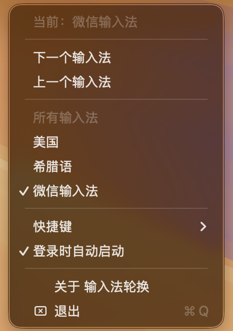

<p align="center">
  
</p>

# 输入法轮换（SwitchIME）

一个 macOS 菜单栏小工具，用来替代系统那个经常失灵的 **Fn / 🌐 键切换输入法**。

系统那个开关的毛病大家都知道：装过第三方输入法之后，Fn 键时不时就不响应了，
而自带的 `⌃Space` / `⌃⌥Space` 走的是同一条代码路径，会跟着一起坏。
SwitchIME 直接调用 Text Input Sources API（`TISSelectInputSource`），完全不参与系统那套
输入源事件处理，所以那边怎么坏都不影响它。

代码只有 700 行左右，没有依赖、没有后台服务、不联网、不要「辅助功能」和「输入监控」权限，
五分钟能读完，确认它没干别的。

> 想要「按 App 自动切换输入法」「屏幕上浮层提示」「双击修饰键切换」这些，用
> [InputSourcePro](https://github.com/runjuu/InputSourcePro) 更合适。
> SwitchIME 只做一件事：顺序轮换。

English: [README.md](README.md)

<p align="center">
  
</p>

## 功能

- 菜单栏常驻图标，显示当前输入法短名（`拼` `微` `美` `あ` `US` …）
- **⌃\`**（Control + 反引号）按系统输入法菜单的顺序切到下一个，转一圈回到第一个
- 点图标可直接跳转到任意输入法，当前项打勾
- 「上一个输入法」用于按过头时退回
- 「登录时自动启动」自己写 LaunchAgent，不依赖额外的 helper
- **中英文界面**，跟随系统语言自动切换，**连 App 图标都会跟着变**（英文 `A` / 中文 `文`）
- **增删输入法即时生效**：不用重启 App，下次按键就重新读一遍列表
- **标签自动去重**：同时启用「简体拼音」和「双拼」时，图标显示 `简体` / `双拼` 而不是两个 `拼`

## 安装

从 [Releases](../../releases) 下载 `SwitchIME-*-universal.zip`，解压后把 `SwitchIME.app`
拖进 `/Applications`，双击运行即可（菜单栏右侧出现图标）。

App 只做了 ad-hoc 签名（这个项目没有买 Apple 开发者证书），所以首次打开系统会拦一下，
任选一种方式放行：

- Finder 里右键 App →「打开」→ 再点「打开」
- 系统设置 → 隐私与安全性 → 往下滚 → 「仍要打开」
- 终端执行 `xattr -dr com.apple.quarantine /Applications/SwitchIME.app`

## 使用

| 操作 | 效果 |
| --- | --- |
| 点菜单栏图标 | 展开菜单，可点选任意输入法（当前项打勾） |
| **⌃\`** | 顺序轮换到下一个输入法，到底后回到第一个 |
| 菜单「上一个输入法」 | 逆序轮换，按过头了可以退回 |
| 菜单「快捷键」 | 换成 `⌃⇧\`` / `⌃⇧Space` / `⌃Space` / `⌃1` |
| 菜单「登录时自动启动」 | 写入/删除 `~/Library/LaunchAgents/com.weiqi.switchime.plist` |
| 菜单「退出」 | 退出 |

界面语言跟随系统：系统是中文就显示中文，是英文就显示英文（输入法名字由 macOS 提供，也会跟着变）。

快捷键默认全是 Control 组合，避开 Option 被大量 App 占用的坑。
另外默认的 `⌃\`` 在 VS Code（切换终端）和 JetBrains（切换配色）里有同款绑定，
如果你的工作流依赖它们，菜单里换一个组合即可。

## macOS 输入源 API 的几个坑

这部分比代码本身更值得看，都是实际踩出来的：

**1. 启用 / 禁用输入源是异步的。**
`TISDisableInputSource()` 返回 `noErr`，但输入源仍然处于启用状态，几百毫秒后才真正生效，
而且对 IME 可能要几秒。只能轮询等待，用固定 `sleep()` 一定会翻车。

**2. 不是所有「已启用」的输入源都能切换。**
中日韩输入法会同时暴露一个父级条目（比如 `com.apple.inputmethod.Kotoeri.RomajiTyping`）
和若干模式，父级条目的 `kTISPropertyInputSourceIsSelectCapable` 是 `false`，必须过滤掉。
但 `TISCopyCurrentKeyboardInputSource()` 有时偏偏返回父级——所以「当前输入法不在我的列表里」
是常态而不是异常。写成 `if let i = list.firstIndex(of: current)` 就会卡住不动。
SwitchIME 的做法是维护一个 anchor（上一次成功切到的 id），当前 id 认不出来时用它兜底。

**3. `TISInputSource` 是 ARC 管理的 CF 对象。**
`takeRetainedValue()` 已经把所有权交给 ARC，再手动
`Unmanaged.passUnretained(_:).release()` 就是过度释放，会在之后某次调用里
`SIGTRAP` 崩掉，崩的位置离真正的 bug 很远。别写。

**4. 状态栏标签会撞车。**
把名字映射成一个字（`拼`、`あ`、`希`）很省地方，直到用户同时启用同一门语言的多个变体。
SwitchIME 分阶段加长：1 个字 → 2 个字 → 去掉公共前缀取区分段 → 加序号，
一旦所有标签都不重复就停下。例如 `希腊语` / `希伯来语` 会变成 `希腊` / `希伯`。

**5. 安全键盘输入会屏蔽一切。**
密码框、1Password、部分终端会打开 secure event input，此时系统会静默拒绝所有输入源切换，
Fn 键也一样，没有任何绕法。App 会检测 `IsSecureEventInputEnabled()` 并弹窗说明，
而不是假装切换了。

## 自行编译

需要 Xcode Command Line Tools（`xcode-select --install`）。

```bash
./build.sh          # 生成 SwitchIME.app，arm64 + x86_64，ad-hoc 签名
```

源码两个文件：

- `Sources/InputSources.swift` — TIS 封装、轮换算法、标签生成（不依赖 AppKit，可单测）
- `Sources/main.swift` — 状态栏、全局热键（Carbon）、LaunchAgent、菜单

## 测试

纯逻辑测试（不碰系统输入法，CI 里跑的就是这个）：

```bash
swiftc -swift-version 5 Sources/InputSources.swift Tests/logic/main.swift \
       -o /tmp/logic -framework Carbon && /tmp/logic
```

App 内置自检（会真实切换输入法，最后恢复）：

```bash
./SwitchIME.app/Contents/MacOS/SwitchIME --self-test --log ./self-test.log
```

动态增删测试（会临时启用/禁用一个键盘布局，结束后恢复原状）：

```bash
swiftc -swift-version 5 Sources/InputSources.swift Tests/dynamic/main.swift \
       -o /tmp/dynamic -framework Cocoa -framework Carbon && /tmp/dynamic
```

动态测试覆盖：轮换下标的边界情况（空列表 / 单项 / 回绕 / 当前项不在列表）、标签去重、
连续 200 次读取当前输入法、添加输入法后能切换并继续轮换、删除输入法后列表与当前状态自洽、
切到不存在的 id 安全失败、结束时恢复现场。

## 多语言

界面文案在 `Resources/<语言>.lproj/Localizable.strings`。要加一门语言：把 `Resources/en.lproj`
复制成 `Resources/<语言>.lproj`，翻译里面的值（`InfoPlist.strings` 里是 App 显示名和图标文件名），
再把语言代码加进 `Info.plist` 的 `CFBundleLocalizations` 即可。

每门语言还可以有自己的图标：加一个 `Resources/AppIcon-<语言>.icns`，然后在该语言的
`InfoPlist.strings` 里把 `CFBundleIconFile` 指过去。

不用改系统语言就能验证某门语言：

```bash
./SwitchIME.app/Contents/MacOS/SwitchIME -AppleLanguages '(ja)' --self-test --log ./st.log
```

## 已知限制

- 只做顺序轮换，不按 App 记忆输入法（要这个请用 InputSourcePro）
- 全局快捷键是独占的：注册 `⌃\`` 之后，原来用这个键的 App 就收不到了
- ad-hoc 签名，没有公证，首次打开会有 Gatekeeper 提示
- 没有沙盒（开机自启的后台 App 需要这样），但它不申请任何权限、不发任何网络请求

## 卸载

```bash
rm -rf /Applications/SwitchIME.app
rm -f  ~/Library/LaunchAgents/com.weiqi.switchime.plist
defaults delete com.weiqi.switchime 2>/dev/null
```

若当前会话里图标还在，先点菜单「退出」。

## 许可证

[MIT](LICENSE)
